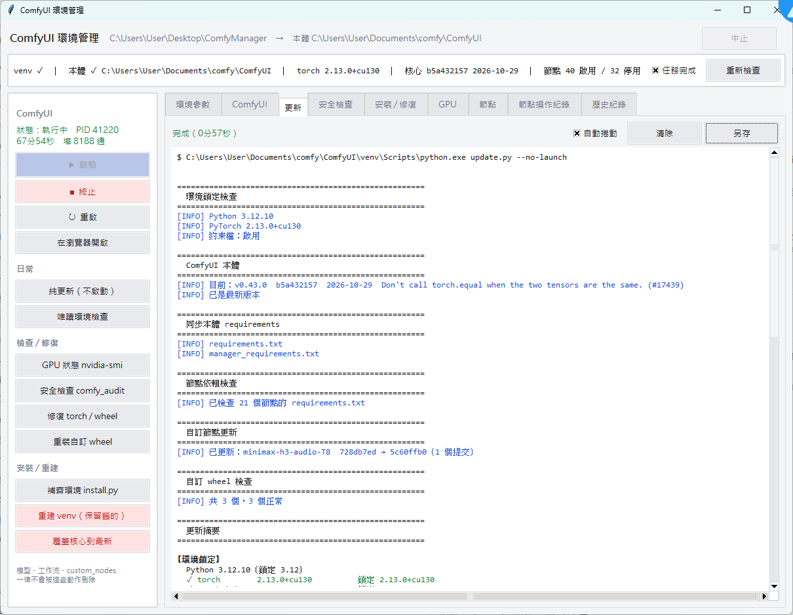

# ComfyUI 環境管理工具

一套給 Windows + NVIDIA 的 ComfyUI 環境管理腳本，附圖形介面。

ComfyUI 跑久了最常見的問題不是壞掉，是**慢慢歪掉**：某個節點的 `requirements.txt`
把 PyTorch 換成 CPU 版、把 NumPy 降回 1.x，然後其他節點連鎖出錯，而你完全不知道
是誰幹的。這套工具的重點就是把「誰動了什麼」變成看得見的紀錄，並且自動還原。



---

## 它解決什麼

| 問題 | 做法 |
|---|---|
| 節點的依賴互相打架，torch 被換掉 | 每次 `pip install` 都帶約束檔，違反的會**安裝失敗並列在摘要裡**，而不是默默換掉 |
| 不知道是哪個節點弄壞環境 | 每個節點的 requirements 分開安裝，前後各拍一次套件快照，異動歸咎到來源 |
| 更新被「本地改動」擋住 | 自動還原被刪掉的空佔位檔（`put_*_here` 這類），真正的改動則點名給你看 |
| 升級後想退回 | 節點的 commit 與啟停狀態存成快照，可比對、可還原 |
| 關不掉 ComfyUI、殘留程序佔著 VRAM | 連同子程序一起終止，並等連接埠真的釋放；另外抓得出抱著 CUDA context 的孤兒 worker |
| 看不到 ComfyUI 的 console | 直接讀 ComfyUI 的 log 端點，**有顏色**，而且不管它是誰啟動的 |

---

## 系統需求

### Python 3.12（必要）

**[python-3.12.10-amd64.exe](https://www.python.org/ftp/python/3.12.10/python-3.12.10-amd64.exe)**
— [發行頁面](https://www.python.org/downloads/release/python-31210/)

安裝時務必勾 **Add python.exe to PATH**。

> **為什麼是 3.12.10 而不是更新的 3.12.x？**
> 3.12.10 是 Python 3.12 系列**最後一個提供 Windows 安裝檔**的版本。
> 之後的 3.12.11 ~ 3.12.14 都只發布原始碼的安全性修補，官方不再提供二進位安裝檔。
> 想用更新的版本就得自己編譯，對這個用途沒有意義。

> **為什麼不用 3.13？**
> 很多 ComfyUI 節點和自編 wheel（flash-attn、SageAttention 這類）還沒有 3.13 的版本。
> 版本鎖定寫在 `comfy_env.py` 的 `PY_MAJOR_MINOR`，要改隨你。

### 其他

- **Windows 10 / 11**（用到 `winreg`、`taskkill`、WMI）
- **Git** — [git-scm.com](https://git-scm.com/download/win)
- **NVIDIA 驅動** — 不需要 CUDA Toolkit，PyTorch 的 wheel 自帶 CUDA runtime

### 相依函式庫

**沒有。** 全部用 Python 標準庫，包括圖形介面（tkinter 隨 Windows 安裝檔一起裝）。

唯一的例外是 `packaging`，用來比對節點 requirements 有沒有被滿足 ——
而它在 `comfy_env.py` 裡有兩段備援：

```python
try:
    from packaging.requirements import Requirement
except ImportError:
    try:
        from pip._vendor.packaging.requirements import Requirement   # pip 自帶的
    except ImportError:
        Requirement = None                                           # 跳過該項檢查
```

所以**不需要 `pip install` 任何東西**就能跑。

---

## 安裝

1. 裝好 Python 3.12.10 和 Git
2. 把這個 repo 的檔案解壓到一個資料夾（**不一定要**放在 ComfyUI 裡，見下面）
3. 執行 `install.bat`

`install.py` 會自己處理：ComfyUI 本體不存在就 `git clone`、venv 沒有就建、
然後依序裝 pip → PyTorch → 本體 requirements → 額外套件 → 節點依賴 → 自訂 wheel。

全新的機器從零開始也是這一行。

---

## 工具可以放在 ComfyUI 外面

本體路徑寫在腳本目錄的 **`comfy_root.txt`**（一行路徑，絕對或相對皆可），
介面的「環境參數」第一個欄位就是它。

這樣 ComfyUI 的目錄不會被塞一堆 `.py` 和 `.bat`，重裝或 `git reset` 也不會波及工具。

```
你的工具資料夾/          ComfyUI/
├─ comfy_root.txt       ├─ main.py
├─ comfy_env.py         ├─ custom_nodes/
├─ update.py            ├─ models/
├─ install.py           ├─ user/
├─ comfy_manager.py     └─ venv/
├─ update_logs/
├─ env_state/
├─ node_backups/
└─ wheels/
```

沒設定的話會自動尋找，順序是：

1. 環境變數 `COMFY_ROOT`
2. `comfy_root.txt`
3. `comfy_env.py` 的 `COMFY_ROOT`
4. 附近：腳本目錄本身 → 底下一層 → 上一層 → 上一層的其他子資料夾
5. 慣例位置：`~\Documents\comfy\ComfyUI`、`~\Documents\ComfyUI`、
   `~\OneDrive\Documents\comfy\ComfyUI`、`~\ComfyUI` 等
6. 都找不到 → 退回腳本目錄，狀態列標示「本體 ✗」

第 4 步刻意只看附近。一路往上掃會在磁碟根目錄那種地方撞到別人的 ComfyUI，
**認錯目錄比找不到更糟**。

相對路徑是以腳本目錄為基準，所以可攜碟插到別台電腦、磁碟代號從 `D:` 變成 `E:`
也不會失效。

---

## 用法

### 圖形介面

```
manager.bat              保留 console，看得到錯誤
make_shortcut.bat        建立桌面捷徑（無 console，用 comfyui.ico）
```

### 命令列

```
install.bat                      安裝 / 補齊環境
install.bat --recreate --venv-only   只重建 venv，不裝套件
install.bat --overwrite-core     順便把本體覆蓋成上游最新
update.bat                       更新本體與節點
update.bat --no-launch           純更新，不啟動 ComfyUI
scan.bat                         安全檢查
run.bat                          啟動 ComfyUI

python comfy_env.py              唯讀體檢（不裝不刪不改）
python comfy_nodes_backup.py add <git 網址>     安裝節點
python comfy_nodes_backup.py save "說明"        建立節點快照
python comfy_sys.py strays                      找殘留程序
```

---

## 設定

全部在 `comfy_env.py` 最上面的「設定區」，介面的「環境參數」分頁可以直接改。

```python
PY_MAJOR_MINOR = (3, 12)
CUDA_TAG       = "cu130"
TORCH_PINS     = {"torch": "2.13.0", "torchvision": "0.28.0", "torchaudio": "2.11.0"}
FLOOR_PINS     = {"numpy": "2.0"}       # 只鎖下限，被降版會自動升回
USE_CONSTRAINTS = True                   # 每次 pip 都帶約束檔
BLOCKLIST      = {"tensorflow": "transformers 會自動 import，與 NumPy 2.x 不相容", ...}
EXCLUDE_NODES  = {}                      # 不自動 git 更新的節點（依賴仍檢查）
PIN_CORE       = None                    # 填 commit 或 tag 可鎖本體版本
NODE_PINS      = {}                      # 個別節點鎖版
LAUNCH_ARGS    = ["--reserve-vram", "1", "--enable-manager", "--listen", "127.0.0.1"]
```

`BLOCKLIST` 的運作方式：裝到就移除，而且會告訴你**是哪個節點的 requirements
把它拖進來的**，不然你每次更新都會重複遇到同一件事。

---

## 幾個設計上的決定

**介面跑在系統 Python，不是 venv。** 它只用標準庫，而「重建 venv」不可能從
venv 裡面重建自己。要不要用 venv 是每個動作各自決定的：

| | |
|---|---|
| 系統 Python | 補齊環境、重建 venv、覆蓋核心 |
| venv | 純更新、環境修復、重裝 wheel、安全檢查（會動 `site-packages`） |

**關掉介面不會影響 ComfyUI。** ComfyUI 的 stdout 接 `DEVNULL`（輸出走 HTTP），
沒有管線綁著，所以介面關掉它照常跑。下次開啟用**連接埠**接回來，不是 PID —— PID
會被系統回收，而外部啟動的本來就不在紀錄裡。

**console 用 HTTP 讀。** `GET /internal/logs/raw` 拿到的是 ComfyUI 原樣攔下的
stdout/stderr，ANSI 色碼都在，跟網頁版底部那個 Logs 面板是同一份資料。管線只有
建立它的程序讀得到，所以 `run.bat` 開的 ComfyUI 用管線是接不到的，HTTP 則不管
誰啟動的都看得到。

**所有會阻塞的事都在背景執行緒。** Tkinter 的重繪和回呼排在同一個事件迴圈，
一個 `subprocess.run` 就會凍住整個視窗。WMI 查詢一次 300–800 ms、`import torch`
兩到五秒、殺程序最多等 20 秒 —— 這些全部丟背景佇列，主執行緒零 I/O。

---

## 安全性

ComfyUI **沒有任何身分驗證**，誰連得到 `/prompt` 和 `/upload/image` 就能在你的機器上
執行工作流。兩個建議：

- `--listen 127.0.0.1`，不要用 `0.0.0.0`
- **不要加 `--enable-cors-header "*"`**。那等於允許你瀏覽的任何網頁對本機的 ComfyUI
  發請求 —— 綁 `127.0.0.1` 擋得住外網，擋不住你自己的瀏覽器

`scan.bat`（`comfy_audit.py`）會檢查節點來源、最近異動的檔案、可疑的網路呼叫那些。

---

## 會自動產生的東西

```
update_logs/    每次任務的完整紀錄
env_state/      節點快照、pip freeze、約束檔、介面狀態
node_backups/   節點版本備份（存 commit 和啟停狀態，不是複製整個資料夾）
comfy_root.txt  本體路徑設定（更新時不會被覆蓋）
```

---

## 授權

MIT
